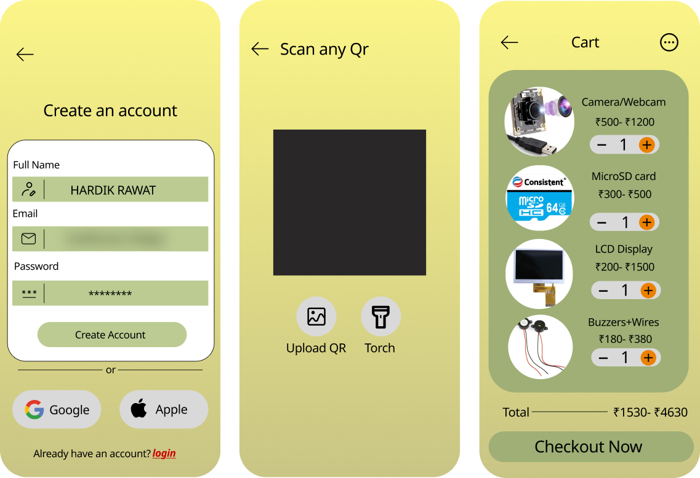

# How CartLess Checkout got here

CartLess Checkout started as a Figma design in July 2026, became an AI-generated app prototype in August and ended up as a working self-checkout cart with its own server, a Raspberry Pi on the cart and a live website, in October 2026. This page records each stage, what changed, and why.

## Timeline

| When | Stage | What it was |
|---|---|---|
| Jul 2026 | **Design in Figma** | Five phone screens: sign-up, home, QR scanner, profile, cart |
| 10–22 Aug 2026 | **Prototype on Lovable** | "SmartCart Pro": a scan-to-cart phone app, generated with Lovable (AI app builder) |
| Sep 2026 | **Development guide** | Our own design: Flask + MySQL server, HTML/JS website, 2× ESP32 + ESP32-CAM on the cart |
| 30 Sep 2026 | **First own code** | Flask website uploaded to GitHub, built for the ESP32 hardware |
| 5 Oct 2026 | **Switch to Raspberry Pi** | The college gave us a Raspberry Pi 4; one Pi + Pi Camera v2 replaced all three ESP32 boards |
| 6–10 Oct 2026 | **v2.5 → v2.8.5** | Exit gate, wallet, general store, smart-shopping features, security hardening |
| 10 Oct 2026 | **Public release** | This repository, with the live demo on Render |

## Stage 0: the Figma design (July)

  

The idea started as phone screens drawn in Figma: sign-up (email, Google or Apple), a home page, a QR scanner, a profile page and a cart (three shown here). The design fixed the things that stayed: a yellow-to-olive theme, a bottom tab bar (Home, Scan, Cart, Profile), scanning a QR code with **Upload QR** and **Torch** buttons, and a cart of electronics parts shown as **price ranges** in rupees with a **Checkout Now** button.

## Stage 1: the Lovable prototype (August)

  

**Live prototype:** https://id-preview--6f1716a0-37d3-41ab-8177-4ef08ea9a9e9.lovable.app

We turned the Figma design into a working app with Lovable: a phone-first shop where you scan a QR code on an electronics part, see it, add it to a cart and check out. Over 16 edits between 10 and 22 August we added dark mode, an admin product-upload flow, a QR code on the receipt and a printable PDF receipt.

- **Stack:** React (TanStack Start), TypeScript, Tailwind + shadcn/ui, Supabase for login and database
- **Shop:** 6 electronics parts (Raspberry Pi 5, webcam, microSD card, 16×2 LCD, buzzer kit, sensor pack), priced as dollar ranges
- **Checkout:** records an order; no payment, no hardware, nothing checks that the scanned item is really in the cart

It kept the Figma layout almost screen for screen (even the Google and Apple sign-in buttons and the profile's settings list) but switched prices to dollars. It proved the screens and the flow (Home → Scan → Cart → Profile), but it was a shopping app, not a smart cart.

## Stage 2: our own design (September)

We wrote a development guide that kept the prototype's flow and added the part that makes a cart "smart": **checking that what was scanned is what was put in the cart**. Weight alone can be fooled by swapping an item for one of the same weight, so the guide checked **barcode + weight + camera** together.

- Rewritten as our own code: **Flask + MySQL** server and a plain **HTML/CSS/JS** website, so we understood and controlled every part
- Hardware plan: **ESP32 #1** reads the load cell (HX711), **ESP32 #2** forwards readings over WiFi, an **ESP32-CAM** photographs the item

The first version of this code went onto GitHub on 30 September.

## Stage 3: Raspberry Pi (5 October)

The college provided a Raspberry Pi and asked us to build with it. One **Raspberry Pi 4 + Pi Camera v2** replaced all three ESP32 boards, and the server needed no changes because the Pi used the same hardware endpoints.

It also made the design better: the weight and the photo now come from one board at the same moment, so they always belong to the same item, and it is one program to maintain instead of three.

## Stage 4: v2.5 to v2.8.5 (6–10 October)

| Version | What it added |
|---|---|
| v2.5 | Pi camera as the **exit gate** (reads the bill QR), Google sign-in, in-memory product cache |
| v2.6 | One scanner for printed **barcodes and QR codes**; **CartLess Wallet** with top-up tokens paid by cash or UPI |
| v2.7 | **General store** of 48 items in 8 sections, admin dashboard, "item not scanned" alert, product photos, install as an app |
| v2.8 | Shopping list with store map, offers with MRP, budget, Call staff (ideas taken from Amazon Dash Cart, Instacart Caper and DMart Scan & Go) |
| v2.8.1–v2.8.5 | Pi reads wallet tokens, libraries served from our own site, works in the Pi's own browser, no default secrets in the code |

The six electronics parts from the Lovable prototype are still in the shop today, in the "Electronics & Hobby" section.

## Prototype vs final

| | Figma design (Jul) | Lovable prototype (Aug) | CartLess Checkout v2.8.5 (Oct) |
|---|---|---|---|
| Built by | Drawn by us | AI app builder, from our prompts | Our own code, written and tested with AI help |
| Server | None (screens only) | Supabase (hosted) | Flask + MySQL on Render + Aiven |
| Website | 5 static screens | React + TypeScript | Plain HTML, CSS and JavaScript, installable app |
| Shop | 4 parts in the cart, ₹ price ranges | 6 electronics parts, $ price ranges | 48 everyday items in 8 sections, ₹ prices with MRP and offers |
| Scanning | QR (Upload QR, Torch) | QR codes only | Printed barcodes (EAN/UPC/Code 128/39) and QR labels |
| Is the item really in the cart? | Not designed | Not checked | Barcode + weight + camera colour must agree; unscanned items trigger an alert |
| Hardware | None | None | Raspberry Pi 4, Pi Camera v2, load cell + HX711, LEDs, buzzer |
| Paying | Checkout Now button | Order recorded, no payment | CartLess Wallet, topped up by cash or UPI with one-time tokens |
| Leaving the shop | Nothing | Nothing | Signed, one-time exit pass QR checked by the Pi camera |
| Staff tools | None | Product upload | Wallet counter, exit gate, dashboard, sales CSV, help calls |

## What we learned

- **A prototype is for testing the idea, not the build.** Figma fixed the look and Lovable showed us the flow in days; owning the code is what let us add hardware, a wallet and fraud checks.
- **The hard part of a smart cart is trust, not the shop.** Most of the work after August went into checking that the cart matches the bill.
- **Hardware changes are cheaper when the server doesn't care.** Because the boards only talk to a fixed set of endpoints, swapping three ESP32s for one Pi took a day.

## Renamed (October 2026)

Renamed to CartLess Checkout: Self-Billing Using Your Own Phone, because "Smart Billing Cart" did not describe the idea: the shopper bills themselves on their own phone, so there is no billing queue. Earlier entries above keep the names used at the time.
