# CartLess Checkout: Self-Billing Using Your Own Phone

*Formerly called SmartCart / Smart Billing Cart. The live demo address still uses the old name.*

**Scan as you shop, pay from your phone, walk out. No billing queue.**

CartLess Checkout is a self-checkout cart for a neighbourhood general store. Shoppers scan items with their phone. A Raspberry Pi on the cart weighs and photographs each item to check it matches the scan. The shopper pays from a CartLess Wallet, and the Pi camera checks the bill QR at the exit.

**Live demo:** https://smartcart-gkrx.onrender.com
(free hosting: the first visit after a quiet spell can take about 30 seconds to wake up)

Built as a side project.

<p align="center">
  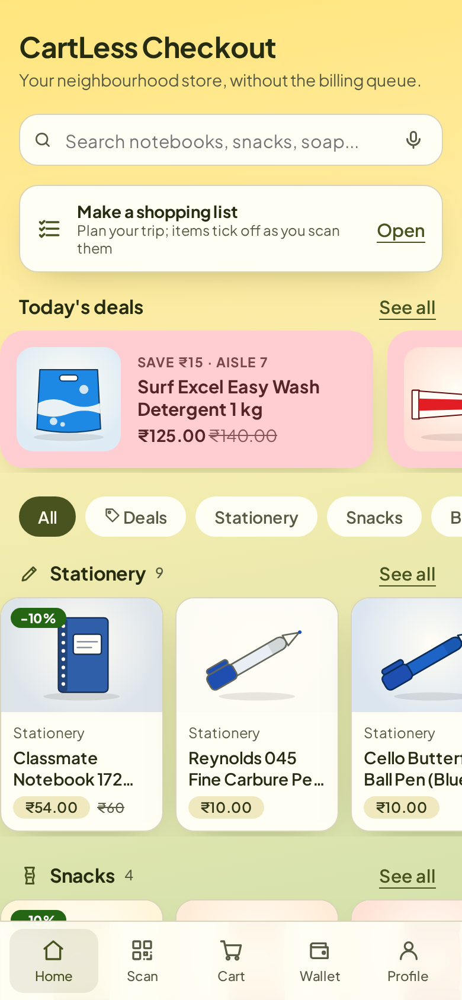
  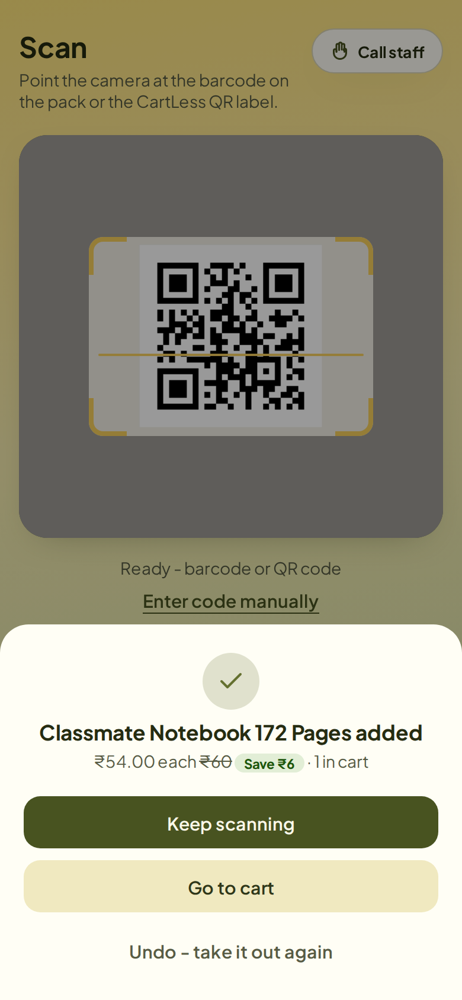
  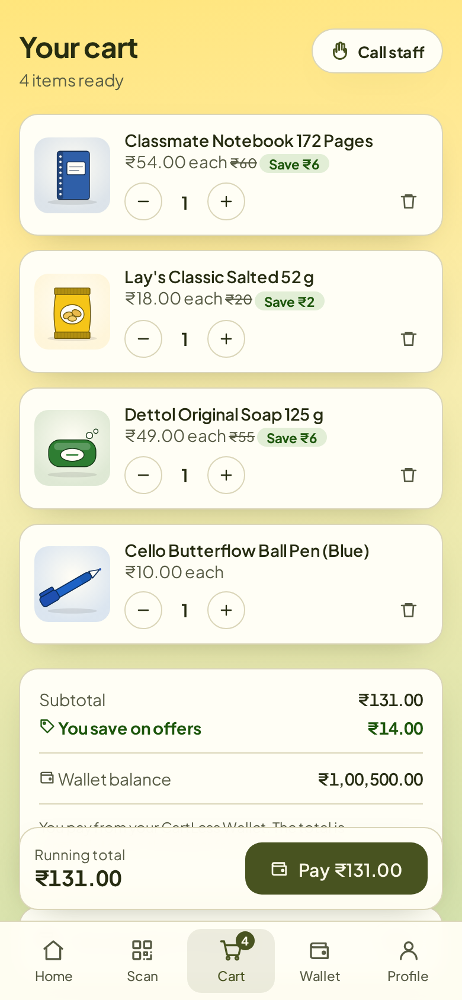
  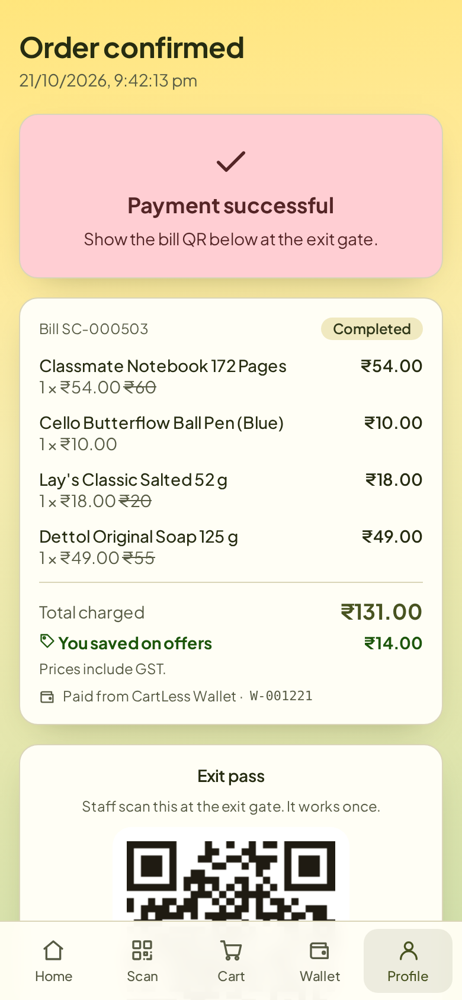
</p>

## How it works

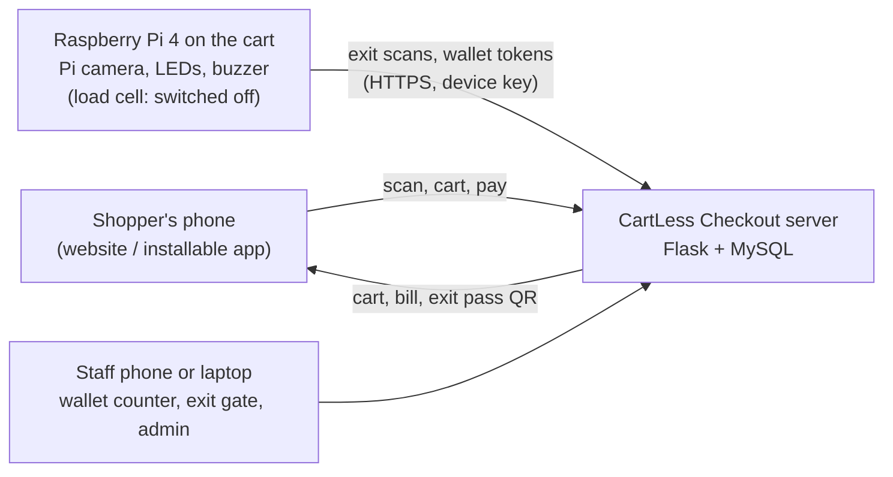

1. **Scan.** The shopper scans the barcode on a pack, or the CartLess QR label, with their phone.
2. **Add to cart.** A known, published barcode adds the item; unknown codes are refused.
   *Built but switched off:* a load cell weighs each item and the Pi camera checks its colour, so an item enters the cart only if the barcode, the weight and the colour agree. Our HX711 board failed, so the server runs with `SCALE_ENABLED` off and the website hides this part. A working scale and `SCALE_ENABLED=1` bring it back.
3. **Pay.** The bill is paid from the shopper's **CartLess Wallet**. They top it up at the counter by cash or UPI using a one-time payment token.
4. **Exit.** The paid bill carries a signed, one-time **exit pass** QR. The shopper holds it under the Pi camera: green light and one beep means OK, red light and beeps means stop.

The Pi never accepts incoming connections. It only calls out to the server over HTTPS with its device key.

## Features

**For shoppers**
- One scanner for printed barcodes (EAN-13/8, UPC-A/E, Code 128/39) and CartLess QR labels
- Running total, offers with MRP and "You saved", and a spending budget with warnings
- Shopping list with a store map that lights up the aisles still to visit; items tick off as they are scanned
- Wallet top-up tokens with a "Pay with a UPI app" button (amount filled in)
- Undo a wrong scan, "Call staff" button, voice search, larger-text option
- Share or print the bill as a PDF; installs as an app on Android and iPhone

**Against theft and mistakes**
- Exit passes are HMAC-signed and work once: screenshots, edited QR codes and reused bills are refused
- Top-up tokens are signed too, and money is added only when staff confirm the cash or UPI payment
- With the scale on (`SCALE_ENABLED=1`): barcode + weight + camera-colour checks, one weighing per scan, and an alert when an item goes in without a scan

**Security**
- Rate limits on the API, a Content-Security-Policy on every page, hashed passwords, signed photo links
- No secrets in the code: keys and the admin password come from the server's settings
- Exact dependency versions; forgot-password handled by staff with a one-time password

**For staff**
- **Wallet counter:** scan a token, take cash or UPI, confirm. A token held under the Pi camera opens there by itself
- **Exit gate:** live results from the Pi camera, plus phone scanning as a backup
- **Admin dashboard:** today's sales, 7-day chart, best sellers, low stock with one-tap restock, flagged scans, Sales CSV
- Help calls from shoppers appear with a beep; staff press "On my way"

<p align="center">
  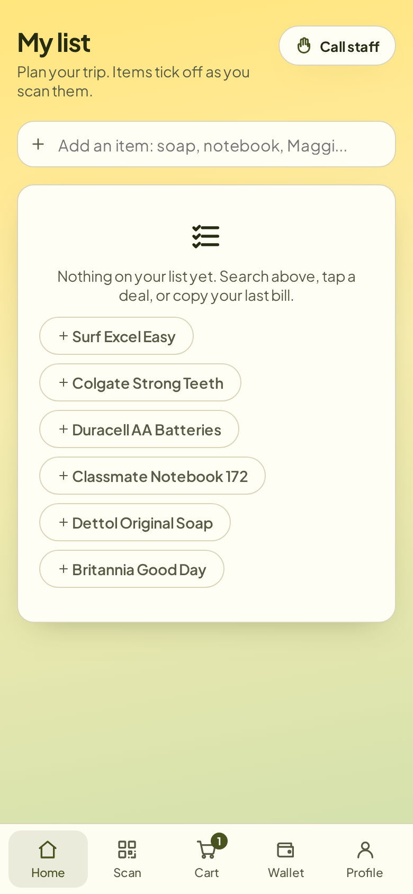
  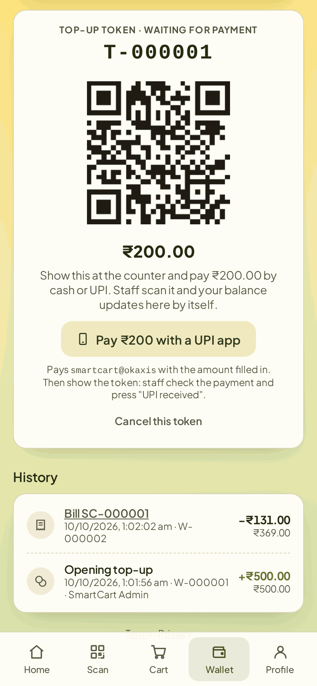
  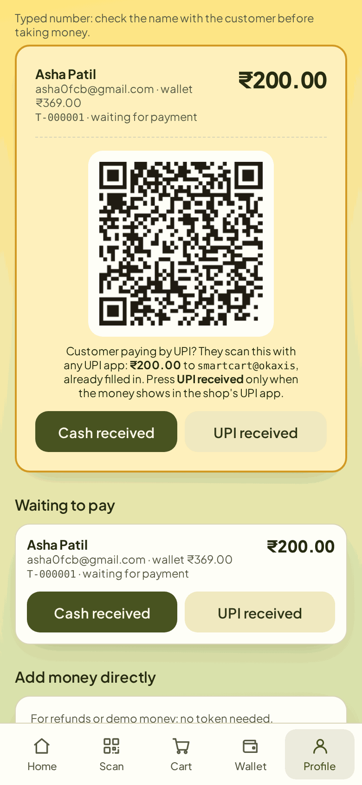
</p>
<p align="center">
  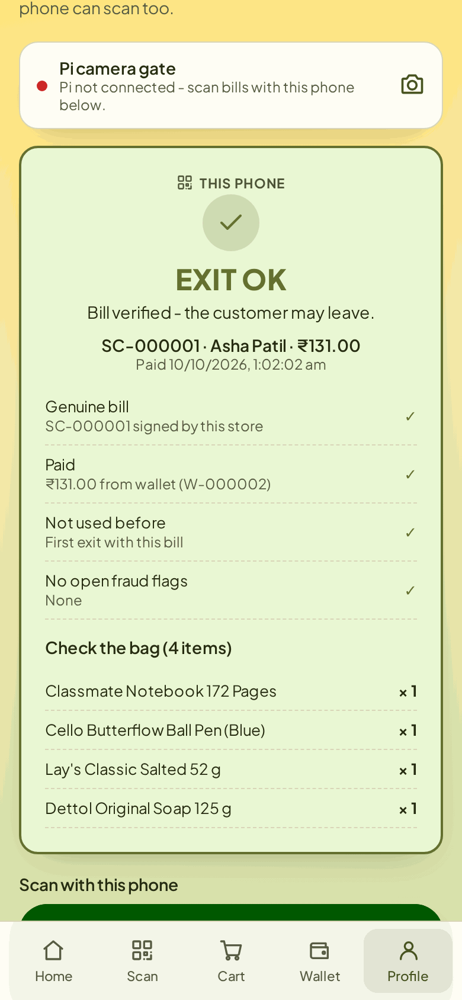
  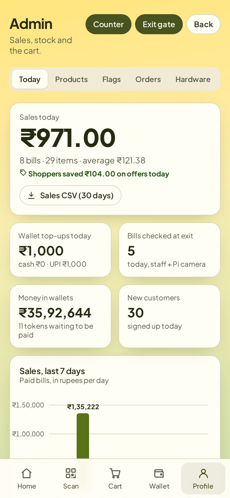
</p>

## Hardware

| Part | Job |
|---|---|
| Raspberry Pi 4 | Runs the cart program `pi/cart_agent.py` |
| Pi Camera v2 | Reads exit passes and wallet tokens (and checks item colour when the scale is on) |
| Load cell + HX711 amplifier | Weighs each item (built; switched off until a working board is fitted) |
| Green LED, red LED (220 Ω each), buzzer | OK / problem signals |

<p align="center">
  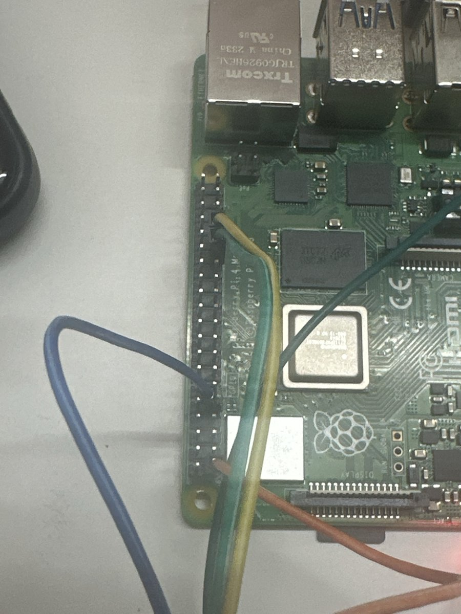
  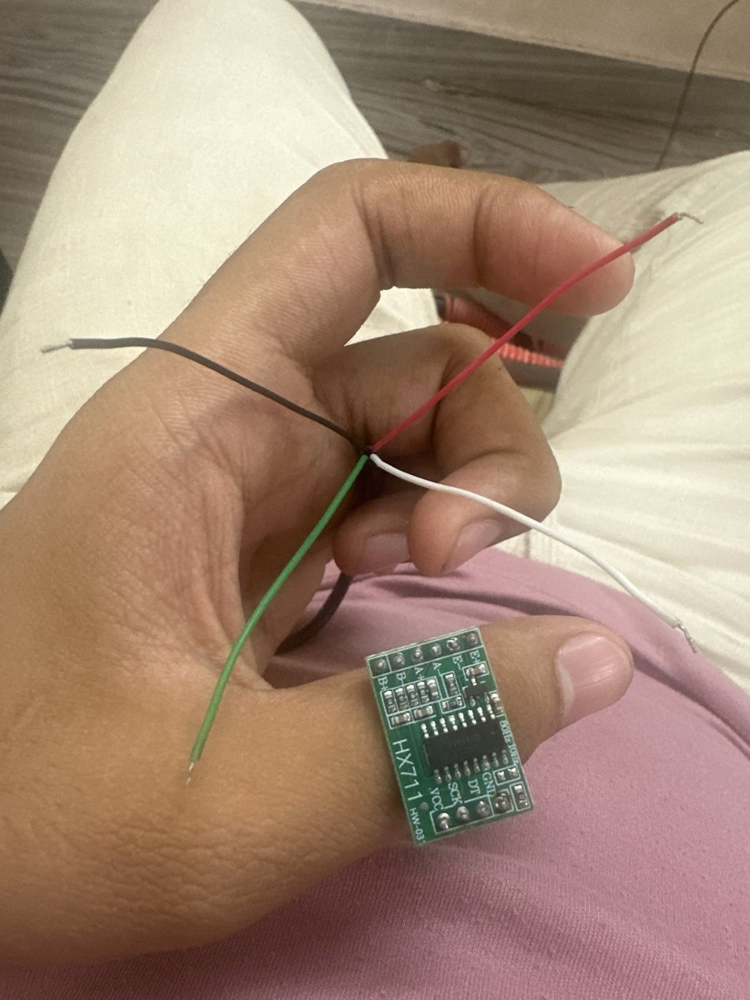
</p>
<p align="center"><sub>Left: the Raspberry Pi 4 GPIO wiring. Right: the HX711 amplifier and the load cell's wires.</sub></p>

**Wiring** (physical pin numbers on the Pi header):

| Wire | Pi pin |
|---|---|
| HX711 VCC | 1 (3.3 V) |
| HX711 GND | 9 |
| HX711 DT | 29 (GPIO 5) |
| HX711 SCK | 31 (GPIO 6) |
| Green LED + | 11 (GPIO 17) |
| Red LED + | 13 (GPIO 27) |
| Buzzer + | 15 (GPIO 22) |
| LEDs and buzzer − | 14 (GND) |

Without the hardware, the website still runs. With `SCALE_ENABLED=1`, an admin-only simulator sends weights and colours, so the weight checks can be demonstrated on a laptop.

## Tech stack

- **Server:** Python, Flask, SQLAlchemy, MySQL 8, JWT login, optional Google sign-in
- **Website:** plain HTML, CSS and JavaScript (no framework), installable as an app with an offline page
- **Raspberry Pi:** Python with lgpio / RPi.GPIO, an HX711 driver, Picamera2, pyzbar for QR codes
- **Hosting:** Render (web) and Aiven (MySQL), both on free plans
- **Bundled libraries:** html5-qrcode, qrcodejs and the Plus Jakarta Sans font, served from the site itself so it works on networks that block CDNs (licences in `frontend-html/vendor/`)

## Run it yourself

Quick start on a PC with Python 3.10+ and MySQL 8:

```
cd smart-billing-cart/backend
copy .env.example .env        (Mac/Linux: cp .env.example .env), then set DB_PASSWORD (and ADMIN_PASSWORD)
python -m venv venv
venv\Scripts\activate         (Mac/Linux: source venv/bin/activate)
pip install -r requirements.txt
python seed.py
python app.py
```

Open http://localhost:5000 and log in as `admin@smartcart.local` with your `ADMIN_PASSWORD` (left blank, `seed.py` makes one up and prints it once). The full guide covers every setting, the Raspberry Pi setup, free 24/7 hosting, Google sign-in and every API route: **[SETUP.md](SETUP.md)**. The Pi program has its own guide in [pi/README.md](pi/README.md).

## Project layout

```
backend/         Flask server: routes, models, wallet, verification, seed data
frontend-html/   Website pages, scripts, styles, icons, bundled libraries
pi/              Raspberry Pi cart program, installer, autostart service
render.yaml      One-click hosting on Render
SETUP.md         Full setup and technical guide
```

## From prototype to product

CartLess Checkout began as a Figma design in July 2026, then an AI-generated shopping-app prototype on Lovable in August (6 electronics parts, no hardware, no checks), moved to our own Flask + ESP32 design in September, switched to a Raspberry Pi in October and reached v2.8.5 with a wallet, an exit gate and barcode + weight + camera verification. The full story, with a side-by-side comparison: **[JOURNEY.md](JOURNEY.md)**.

<p align="center">
  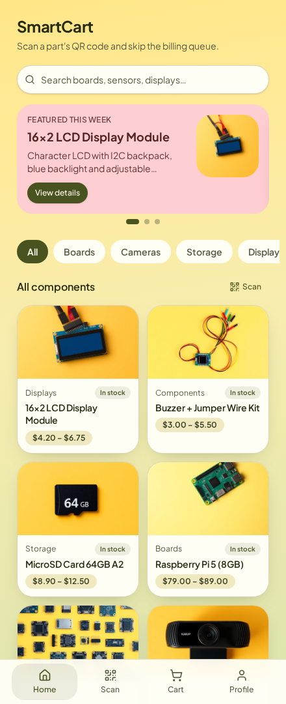
  
</p>
<p align="center"><sub>Left: the Lovable prototype (August). Right: CartLess Checkout v2.8.5 (October).</sub></p>

## Documents

Project documents are in [`docs/project/`](docs/project/):

| File | What it is |
|---|---|
| `CartLess_Checkout_IEEE_Paper.pdf` / `.docx` | Conference paper in IEEE two-column format, with measured results |
| `CartLess_Checkout_MiniProject_Report.docx` | Mini project report (SIES format), titled "CartLess Checkout: Self-Billing Using Your Own Phone", with a survey of five IEEE papers |
| `CartLess_Checkout_SkillLab_Python.pptx` | Skill Lab presentation: CartLess Checkout as a Python project |
| `CartLess_Checkout_Presentation.pptx` | Presentation following the report's chapters |
| `CartLess_Checkout_MiniProject_PPT_SIES_format.pptx` | Presentation in the SIES mini project template |
| `CartLess_Checkout_MiniProject_Logbook.docx` | Mini project logbook (front pages filled) |

Printable product labels for the 48 demo products are in [`docs/labels/`](docs/labels/): one PDF of QR codes and one of barcodes (Code 128, or the pack's own EAN-13). Both hold the same product code, so either one scans. Print at 100%; rebuild them with `python tools/make_labels.py` after changing the catalogue.

The server tests behind the paper's numbers are in [`tests/benchmark/`](tests/benchmark/).

## Team

| Member | Role |
|---|---|
| **Hardik Rawat** | Project lead. Created the first design in Figma and the Lovable prototype the project grew from. |
| Ismail Mohammed | Helped build the backend (server and database). |
| Shivraj Morde | Set up the Raspberry Pi and connected its camera to the website. |
| Pranav Anand | Team member (moral support). |

The same list is on the website's About & team page (`team.html`).

## Licence

MIT. See [LICENSE](LICENSE). Bundled third-party libraries keep their own licences (in `frontend-html/vendor/`).
